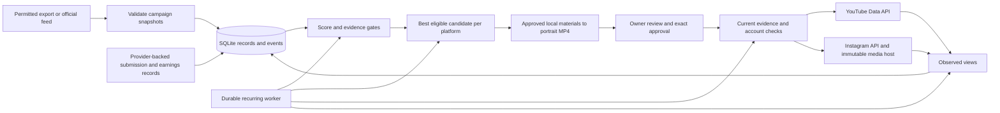

# Architecture

Python 3.12 and SQLite keep the initial system small and inexpensive. No Redis,
database server, browser automation, GPU or paid model endpoint is required.

`models.py` validates snapshots. `ranking.py` explains priorities and rejects
unknown eligibility. `media.py` performs local editing. `integrations.py`
contains isolated official HTTP transports. `feeds.py` adds destination/DNS and
size guards to operator-configured normalized feeds. `service.py` applies
workflow policy, `store.py` persists transactional records/events/schedules,
`cli.py` exposes local operator commands and `api.py` exposes authenticated
HTTP operations.

Publication states are `planned → rendered → approved → publishing → published`.
Failures after a possible external write move to `needs_reconciliation`.
Crashes while publishing retain the durable barrier. A database compare-and-swap
allows only one worker to claim an approved job, and YouTube uploads use a
staged copy of the exact approved bytes. Instagram revalidates campaign and job
approval after container processing before its final publication call.

`oauth.py` supplies in-memory Google refresh/PKCE helpers; `readiness.py` separates
configuration from read-only identity evidence and exact-video preflight.
The cloud observation workflow never loads or exports the private publishing
database and keeps live publishing disabled, regardless of ambient variables.

Production gaps are explicit: verified provider campaign APIs, owner OAuth,
live credential renewal (including Instagram), live platform contract checks, campaign-specific creative validation,
submission/earnings automation, supervised first publication, reconciliation,
scoped consent for broader autonomous publishing, and a deployed persistent
cloud host. Tests cover local functionality and mocked transports; they do not
turn these external prerequisites into verified capabilities.
